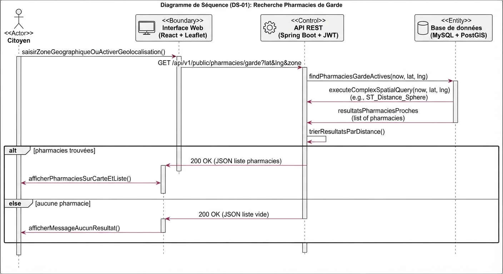
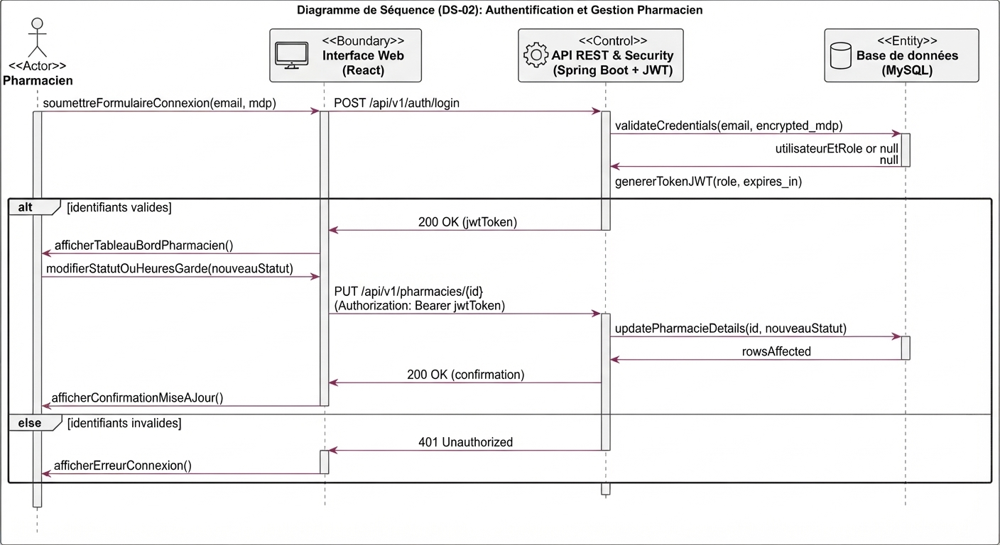
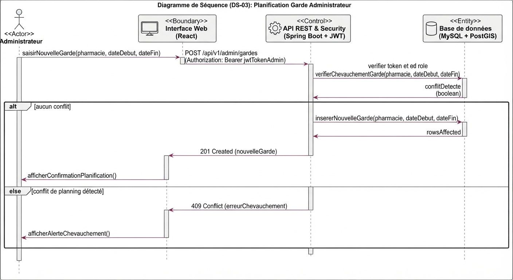

# [S0-3] Diagrammes de Séquence — PharmaGarde

## 1. DS-01 — Recherche des pharmacies de garde à proximité (Citoyen)

## 2. DS-02 — Authentification et mise à jour de l'officine (Pharmacien)

## 3. DS-03 — Planification d'un tour de garde (Administrateur)

